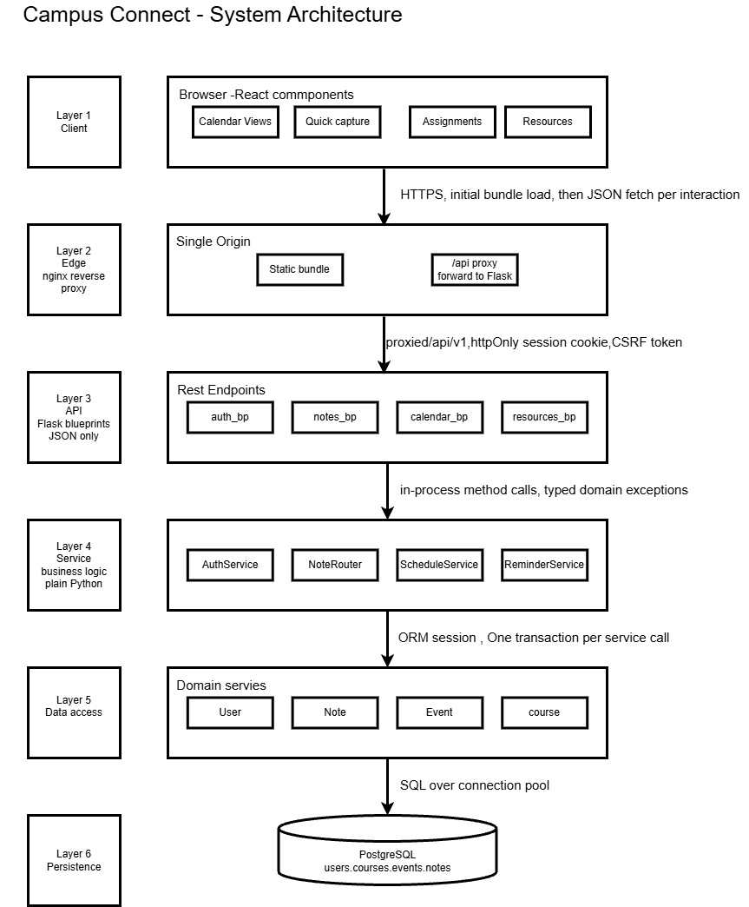
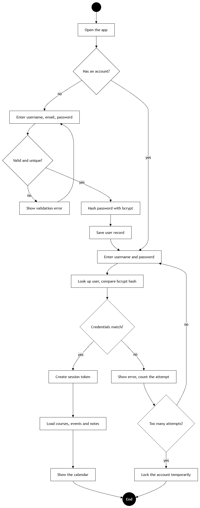
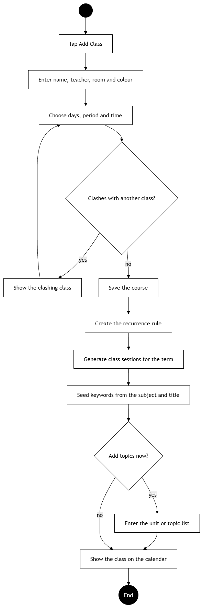
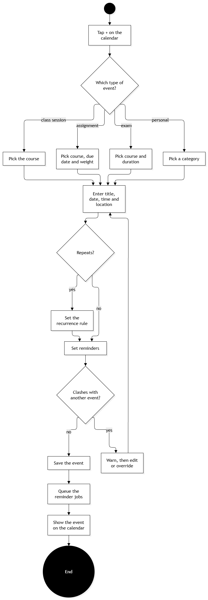
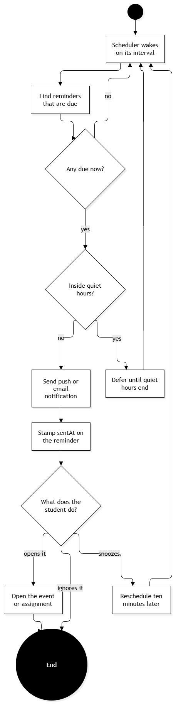

# System Design

## 1. Design Overview

**Project:** [Enter project name]

**Design goals:** [Summarize the qualities this design prioritizes and why.]

**Constraints:** [List technical, schedule, platform, security, or course constraints.]

Store editable diagram sources and readable exported images in `design-assets/`. Use relative links so diagrams display from a fresh repository copy.

## 2. Architecture

### Architecture Style

[Name the architecture style or pattern, such as layered, client-server, MVC, event-driven, or another appropriate choice. Explain why it fits the requirements.]

### Architecture Diagram



**Diagram explanation:** [Explain each component, its responsibility, and how data or control moves through the system.]

| Component | Responsibility | Inputs | Outputs | Related requirements |
| --- | --- | --- | --- | --- |
| [Component name] | [What it does] | [Inputs] | [Outputs] | [FR-01, NFR-01] |

## 3. UML Diagrams

Use the UML diagram types that accurately communicate your system. At minimum, include diagrams needed to explain user interactions, static structure, and important behavior. Label every diagram and keep it consistent with the code.

### 3.1 Use Case Diagram

> [Insert a use case diagram showing actors, system boundary, and major use cases.]

**Explanation:** [Describe actors, use cases, and important include/extend relationships.]

### 3.2 Class or Domain Model Diagram

> [Insert a class or domain model showing names, key attributes/operations, relationships, and multiplicities.]

**Explanation:** [Describe the most important classes/entities and relationships.]

### 3.3 Sequence Diagram(s)

> [Insert at least one sequence diagram for a major scenario or complex interaction.]

**Scenario:** [Name the use case and describe the successful or alternate flow shown.]

### 3.4 Additional Diagram(s)









## 4. Data and Schema Design

### Data Model or Schema Diagram

> [Insert an entity-relationship diagram, database schema, file schema, or object model. If the project stores no data, explain why this section is not applicable.]

| Entity/table/object | Important fields and types | Key or identifier | Relationships and constraints |
| --- | --- | --- | --- |
| [Name] | [field: type] | [Primary key/ID] | [Relationships, validation, uniqueness] |

**Data integrity and privacy:** [Explain validation, error prevention, sensitive data handling, and retention where relevant.]

## 5. Interface Design

### User Interface

> [Insert wireframes, mockups, navigation map, or screenshots with figure numbers.]

[Explain usability, accessibility, consistency, responsive behavior, and how the interface supports requirements.]

### Internal and External Interfaces

| Interface | Producer | Consumer | Data/contract | Error handling |
| --- | --- | --- | --- | --- |
| REST API `/api/v1/...` (also `/api/...`) | Flask blueprints `auth_bp`, `notes_bp`, `calendar_bp`, `resources_bp` | Web app at `/app` (`code/templates/`), served by the same Flask server; React version through the Vite `/api` proxy | JSON request and reply bodies. Dates are `YYYY-MM-DD`, times `HH:MM`. Every route is listed in [`code/api/README.md`](../code/api/README.md) | JSON `{"error", "message"}` (+ `fields` for invalid input) with status 400, 401, 403, 404, 405, 409, 415, 500 or 503 |
| Login: bearer token or session cookie | `AuthService`, `api/session.py` | Frontend, API clients | `POST /auth/login` returns `token` and `csrfToken` and sets an httpOnly cookie. Later requests send `Authorization: Bearer <token>`, or the cookie + `X-CSRF-Token` | `401 unauthorized` (no or wrong token), `401 invalid_credentials` (wrong email or password), `403 csrf_failed` |
| Service methods | `AuthService`, `NoteRouter`, `ScheduleService`, `ReminderService`, `ResourceService` | Blueprints | Checked Python values in, dicts/lists out. Never HTTP objects | Typed exceptions: `ValidationError`, `NotFound`, `InvalidCredentials`, `AlreadyExists` |
| Data access | `api/models.py`, `queries.py` | Services | Parameterized SQL on a pooled connection. Rows come back as dicts | Database errors pass up. Duplicate email → `409`, id out of range → `404` |
| Connection pool | `db.py` | Data access | `DATABASE_URL` from `code/.env`. 1–10 connections, `search_path` set to the project schema | Database unreachable → `503 database_unavailable` |
| Support resources file | `code/api/resources.json` | `ResourceService` | List of `{id, title, category, description, contact, url}`, filtered by `crisis`, `mental-health` or `academic` | Unknown category → `400` |

## 6. Key Algorithms and Logic

**Request flow:**

1. The blueprint checks the login and the input.
2. A service method opens one database transaction and runs the model SQL.
3. The blueprint returns the result as JSON.

Any exception rolls back the whole transaction, and the error handler turns it into a JSON error reply.

```text
request -> authenticate() -> Fields(body).text(...).date(...).done()
        -> service method:  with pool.connection():  model SQL ...
        -> jsonify(result)        (exception -> rollback -> JSON error)
```

**Login check (every request):**

1. Routes marked public skip the check.
2. If the request has `Authorization: Bearer <token>`, the token is looked up in `api_tokens`.
3. Otherwise the signed session cookie must name a user. For POST/PATCH/DELETE, the `X-CSRF-Token` header must also match the token stored in the session, compared in constant time.

**Reminders:** an unfinished assignment is shown from `daysBeforeAlert` days before its due date until the due date. The query is `status <> 'Completed' AND due_date BETWEEN today AND today + days_before_alert`. Each reminder adds `alertDate = dueDate − daysBeforeAlert` and `daysLeft = dueDate − today`.

**Class ids (slugs):** a new class name becomes a URL-safe id, e.g. "Unix Systems" → `unix-systems`. If that id is taken, `-2`, `-3`, … is added. Renaming a class keeps the id, so links keep working. Deleting a class keeps its events, assignments and notes, with no class.

**Validation:** `Fields` checks each value and collects all errors before it rejects the request, so the user can fix every field in one try. `PATCH` changes only the fields sent and rejects an empty body. Other defaults:

- the due time defaults to 23:59
- a blank note title becomes the first line of the note
- the end time must be after the start time

## 7. Security and Reliability

- **Authentication:**
  - Passwords are hashed with Werkzeug scrypt.
  - Login gives a random token (`secrets.token_urlsafe`) and a signed httpOnly session cookie (SameSite=Lax).
  - Logout deletes the token.
  - An unknown email still runs a password check, so wrong-email and wrong-password logins take the same time and give the same reply.
- **Authorization:** every SQL statement filters by the logged-in user's id. Someone else's item answers `404`, so nobody can tell whether it exists.
- **CSRF:** cookie logins must send the `X-CSRF-Token` from login on every change. Bearer-token requests don't need it, because browsers never add that header by themselves.
- **Input validation and injection:** all input is checked against types, lengths and formats. All SQL uses parameters, and column names go through `psycopg.sql.Identifier`.
- **Error handling and logging:** every error answers in JSON. Database outages (`503`) and unexpected errors (`500`) are logged with their stack trace on the server. The user gets a short message without internal details.
- **Reliability:**
  - One transaction per service call: a failure rolls back the whole change.
  - The connection pool throws away broken connections and opens new ones.
  - Duplicate sign-ups at the same moment are stopped by the unique email constraint.
- **Secrets:** the database password is in `code/.env`, which is not built into the Docker images (`.dockerignore`). The session key comes from `SECRET_KEY`, or a random key is made at startup.
- **Not applicable / not done:**
  - No HTTPS: the app runs locally in development.
  - No backups: the database only holds sample data, and the Docker volume can be rebuilt from `seed.sql`.
  - No rate limiting: this is a class project with no public deployment.

## 8. Design Decisions and Alternatives

| Decision | Alternatives considered | Chosen approach and reason | Tradeoffs |
| --- | --- | --- | --- |
| Layered backend: blueprints → services → models | All logic inside the route functions | Each layer has one job. Services can be reused and tested without HTTP, and the code matches the architecture diagram | More files to follow for a small feature |
| Plain SQL with psycopg | SQLAlchemy ORM | Builds on the team's existing `schema.sql` and `queries.py`. The SQL is easy to read and check | Data access code is written by hand, and the database is changed by editing SQL |
| Werkzeug scrypt password hashing | bcrypt (named in the proposal) | Already included with Flask and as strong as bcrypt, so it needs no extra dependency | Differs from the proposal |
| Bearer token and session cookie + CSRF | Only one login method | The cookie matches the architecture diagram. Tokens keep the frontend and API tools working | Two login paths to maintain |
| Routes at both `/api` and `/api/v1` | Move everything to `/api/v1` | `/api/v1` follows the diagram, and `/api` keeps the existing frontend working without changes | Every route has two URLs |
| No nginx (Layer 2): Flask serves both the web page and the API | nginx reverse proxy | The page and the API share one address, so no proxy is needed. The React version uses the Vite proxy for the same job. Nothing extra to install | Not a production setup |
| Docker Compose for the whole stack | Everyone installs PostgreSQL, Python and Node | One command gives the same setup on every computer. The database runs on port 5433, so it doesn't clash with a local PostgreSQL | Needs Docker Desktop. The first build takes a few minutes |

## 9. Requirements-to-Design Mapping

Keep the full traceability record in `02-requirements-specification.md`. Use this table only to explain design-specific details.

| Requirement ID(s) | Design element | How the design satisfies the requirement |
| --- | --- | --- |
| [FR-01, NFR-01] | [Component/diagram/schema] | [Explanation] |

## 10. Design Review Checklist

- [ ] Architecture, UML diagrams, and schema are complete and readable.
- [ ] Diagram notation, labels, directions, and multiplicities are accurate.
- [ ] Every major requirement is represented in the design.
- [ ] Diagram names and relationships match the implementation.
- [ ] Interfaces, data validation, errors, and important quality attributes are addressed.
- [ ] Design choices and tradeoffs are justified.
